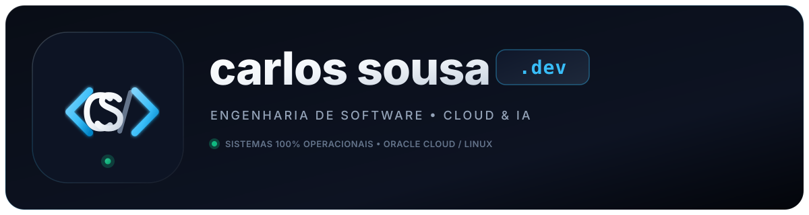

  

---

## 📌 Áreas de Atuação

<table>
  <tr>
    <td width="50%">
      <h3>🎓 EdTech & Learning Platforms</h3>
      
Desenvolvimento, personalização avançada e orquestração de plataformas de e-learning (Moodle LMS, arquiteturas modulares, temas corporativos e integrações formativas).

    </td>
    <td width="50%">
      <h3>☁️ Cloud & Self-Hosting</h3>
      
Desenho e gestão de infraestruturas resilientes baseadas em Docker, Coolify, Traefik Reverse Proxy, MariaDB/PostgreSQL e automatização CI/CD.

    </td>
  </tr>
  <tr>
    <td width="50%">
      <h3>🤖 Agentes de IA & Automação</h3>
      
Sistemas autónomos, pipelines RAG empresariais, agentes de código e extração inteligente de dados não estruturados (OCR de faturas, contratos e relatórios).

    </td>
    <td width="50%">
      <h3>💼 Software & Portais Web</h3>
      
Aplicações à medida para gestão de equipas, acompanhamento de projetos, portais internos de clientes e soluções digitais seguras.

    </td>
  </tr>
</table>

---

## 🛠️ Stack Tecnológica & Ecossistema

---

  © 2026 carlossousa.dev • Projetos Profissionais & Soluções Digitais

